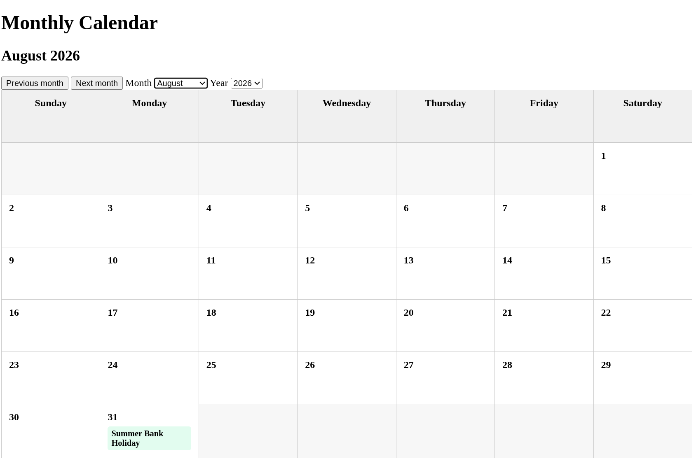
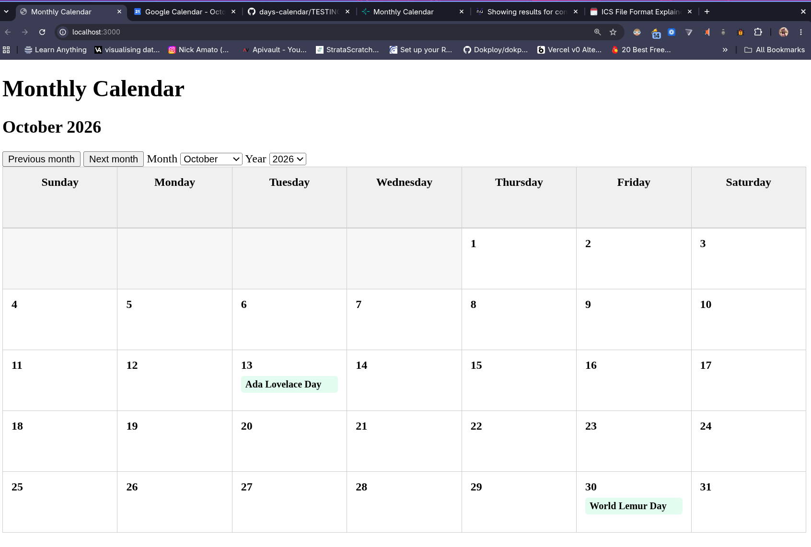
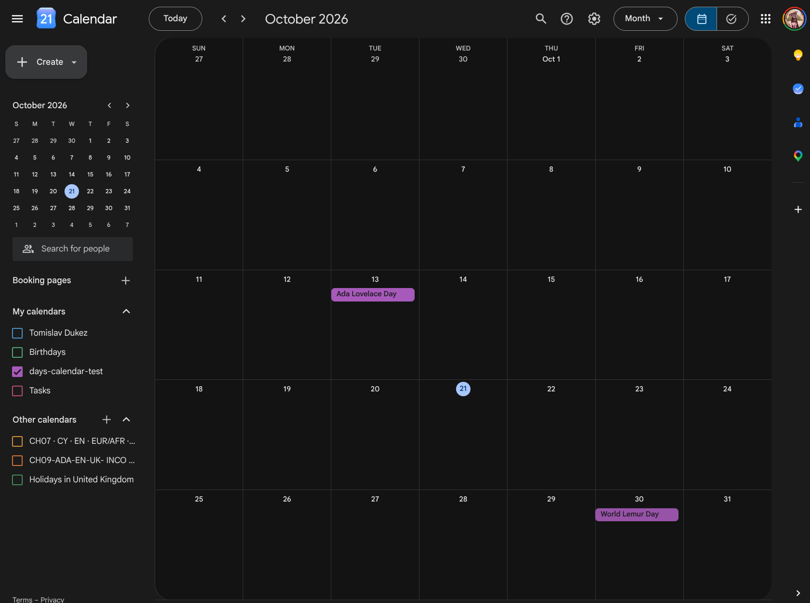

# Project Testing and Evaluation Rubric

## General Requirements (For Everyone)

### 1. Calendar Initial State and Grid Layout (October 2024)

- [x] Open the calendar and verify it defaults to showing the current month.
- [x] Navigate to **October 2024** and observe the following layout details:
  - [x] A calendar grid consisting of 5 rows by 7 columns.
  - [x] **First row check:** Contains Tuesday, October 1 through Saturday, October 5. Sunday and Monday are either labeled for September 29/30 or left blank.
  - [x] **Last row check:** Contains Sunday, October 27 through Thursday, October 31. Friday and Saturday are either labeled for November or left blank.

### Specific Date and Event Verifications

- [x] **October 2024:** Verify that October 8th displays **Ada Lovelace Day** and October 25th displays **World Lemur Day**.
- [x] **October 2020:** Navigate to October 2020 on the web page and verify:
  - [x] October 13th: Ada Lovelace Day.
  - [x] October 30th: World Lemur Day.
- [x] **May 2030:** Navigate to May 2030 on the web page and verify:
  - [x] May 11th: International Binturong Day.

### Month Boundary and Padding Verifications

- [x] Verify that the following months start and end on the specified dates without extra days or padding boxes outside their required weeks:
  - [x] **2024-12:** Starts on Sunday (no empty days before) and ends on Tuesday (4 empty days after).
  - [x] **2025-02:** Starts on Saturday (6 empty days before) and ends on Friday (1 empty day after).
  - [x] **2025-05:** Starts on Thursday (4 empty days before) and ends on Saturday (no empty days after).
  - [x] **2026-02:** Starts on Sunday (no empty days before) and ends on Saturday (no empty days after).

### Navigation and UI Controls

- [x] Test previous and next buttons, including at any defined end-points of the month/year selector.
- [x] If selector end-points exist, verify that previous/next buttons work flawlessly when going beyond those limits.
- [x] Confirm that the UI never displays placeholder strings such as `"undefined"`, `"null"`, `"NaN"`, or empty strings when the current month or year is rendered anywhere in the interface.
- [x] Verify that calendar days continue to render correctly during edge-case navigation.
- [x] Test for jumping directly to a specific month and year.

### Architecture and Code Quality

- [x] Confirm that the UI is generated via DOM manipulation and that day generation is fully dynamic.
- [x] Verify that the calendar handles arbitrary additional days added to the data file successfully.




- [x] Run Lighthouse in **Desktop device mode** across all views on the website and verify a score of **100% for Accessibility**.
- [x] Confirm that unit tests are written and passing for at least one non-trivial function.

  Here's the output of `npm test`:

  ```bash
  > project-days-calendar@1.0.0 test
  > node --test

  ✔ getDateFromDaysObject for Ada Lovelace Day is correct (5.588964ms)
  ✔ getDateFromDaysObject for last occurrence of day of week is correct (0.216107ms)
  ✔ getDateFromDaysObject throws error when month not found (0.271277ms)
  ✔ getDateFromDaysObject throws error when day of week not found (0.162508ms)
  ✔ getDateFromDaysObject throws error when occurrence not found (0.170238ms)
  ✔ getOccurencesForTheMonth for October 2024 is correct (0.314176ms)
  ✔ getOccurencesForTheMonth for October 2025 is correct (0.169828ms)
  ✔ getOccurencesForTheMonth for May 2025 is correct (0.161078ms)
  ✔ getOccurencesForTheMonth for January 2025 is correct (0.173218ms)
  ✔ getOccurencesForTheMonth for August 2026 is correct (0.256047ms)
  ℹ tests 10
  ℹ suites 0
  ℹ pass 10
  ℹ fail 0
  ℹ cancelled 0
  ℹ skipped 0
  ℹ todo 0
  ℹ duration_ms 69.773511
  ```

- [x] Audit the codebase to ensure zero dead code (all written JavaScript and CSS are actively used).

---

## 2. Group Requirements (For Groups of at Least 2)

### iCal Generation and Import

- [x] Run the supplied script using Node.js to generate the `days.ics` file.
- [x] Import the generated `days.ics` file into Google Calendar.
- [x] Verify that all dates and events match the web UI correctly.

  Here's the `October 2026` from the web UI:

  

  Here's the corresponding month in the Google Calendar:

  

### Calendar Event Properties

- [x] Verify that all imported calendar events are configured as **whole-day events** without specific start/end times.

### Code Sharing and Logic Integrity

- [x] Verify that date-calculation logic is appropriately shared and reused between the web generator and the iCal generator.
